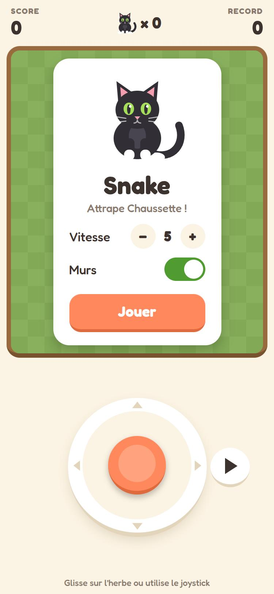

# Chaussette Snake 🐍🐈‍⬛

Un Snake pour iPhone (Expo / React Native) où le serpent doit attraper **Chaussette**, une chatte noire aux quatre pattes blanches.



## Le jeu

- Un serpent dessiné qui glisse en continu, sort la langue et écarquille les yeux quand il approche de Chaussette.
- Quand il l'attrape, elle est aspirée dans la gueule, puis une bosse en forme de chat descend le long du ventre jusqu'à la queue.
- Contrôle au **joystick** (avec un petit retour haptique) ou en **glissant** le doigt sur l'herbe.
- Vitesse de 1 à 9, murs activables (sans murs, le serpent ressort de l'autre côté).
- Record sauvegardé sur le téléphone.

## Lancer le jeu

```bash
npm install
npx expo start
```

Puis scanner le QR code avec l'app **Expo Go** sur iPhone (même Wi-Fi que l'ordinateur).
Pour tester dans un navigateur : `npx expo start --web` (flèches + Entrée/Espace).

## Structure

- `src/game/engine.ts` : logique pure du jeu (grille, déplacements, collisions, repas).
- `src/game/useGame.ts` : boucle de jeu, pause automatique, sauvegarde du record.
- `src/ui/Board.tsx` : rendu SVG de l'herbe, du serpent et des animations.
- `src/ui/Cat.tsx` : dessin de Chaussette.
- `src/ui/Controls.tsx` : joystick et boutons.
